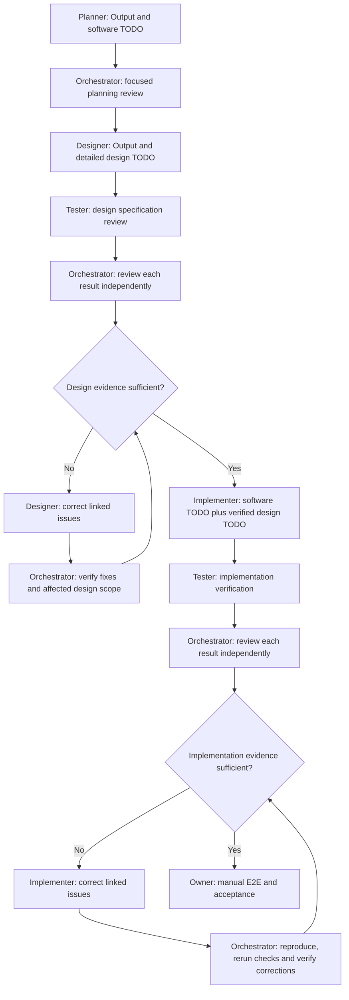

# Delivery cycle — planning, design gate, implementation gate

This is the shared cycle for the reusable role packages. The owner approved this sequence: Planner supplies software construction work; Designer supplies the detailed design work for Implementer; Tester reviews each phase once; Orchestrator reviews every Tester result and personally verifies subsequent corrections. This procedure does not appoint operators, activate blank assignments or authorize dispatch. Read each role's prompt, Roster and actual brief before acting.

## 1. Planner and focused Orchestrator review

Planner creates its internal work TODO, the canonical versioned requirements/engineering Output and **one downstream software TODO**, normally `software.todo.md`, using the Implementer TODO template. Specify proposed paths/names, module/file responsibilities, public boundaries, contracts/data, construction order, dependencies, failure/security concerns, acceptance IDs and local syntax sources. Proposed paths do not become observed project structure until created. Planner does not prepare Designer's execution checklist or detailed visual instructions.

Orchestrator performs a concise substantive review of scope, source/guide coverage, consequential risks, decisions, software tasks and dependencies. Return specific gaps to Planner. Quick review means focused reading, not skipping security or treating proposals as approved. Obtain missing material owner decisions; do not silently approve a plan. Then brief Designer from the reviewed Output and relevant software constraints.

## 2. Designer and the design Tester gate

Designer creates its own internal work TODO and produces one detailed **design TODO for Implementer**, normally `design.todo.md`, using [design TODO template](../../designer/templates/design-todo.md), alongside its Output and actual design artifacts. This deliverable specifies exact implementable screen/component/layout/state/responsive behavior; it is not a second software plan. Each design item links Planner requirement/AC IDs and the relevant software task. Designer owns these details; new business/contract scope returns to Planner through Orchestrator.

Orchestrator sends the actual versioned design TODO/Output and baseline requirements to Tester for a **DESIGN SPECIFICATION** phase. Tester reviews coverage, consistency, measurable layout, responsive rules, interaction and accessibility specifications, approved kit/tokens, source constraints, feasibility and contradictions with software/API/data behavior. Inspect actual visual/prototype artifacts if available and authorized. A textual spec can pass document checks; runtime behavior, rendered contrast, responsiveness and functional accessibility remain unverified until an actual implementation can be checked. No code/build/runtime test is fabricated to fill this phase.

Orchestrator opens the Tester report and independently disposes **each finding, each failed/unverified criterion and each claimed pass's supporting evidence**. Recheck cited rules/artifacts and perform applicable authorized checks; unsupported claims stay unverified. If the evidence supports the phase gate, hand both TODOs to Implementer. If corrections are needed, send a formal issue-linked brief to Designer. Designer returns a new candidate and change evidence. **Orchestrator personally verifies these corrections and the affected/shared design scope; do not send the corrected design back to Tester.** Repeat the Designer ↔ Orchestrator loop until the evidence suffices or record the exact blocker.

## 3. Implementer and the implementation Tester gate

Apply Designer's [owner-preview boundary](../../designer/skillz/owner-preview.md). Any optional concept image is for the owner only, outside the execution package. Pass an explicit allowlist of complete text specifications and implementation-safe review evidence; do not forward private owner records, image links/paths, generation prompts, broad source inventories or any mention that the preview exists. Translate owner decisions into reviewed written requirements/design changes first. The implementation-facing Designer Output is text-only; required production assets remain separately specified actual product inputs.

Implementer receives the current approved software TODO and the actual design TODO/version that passed the design gate. Continue the software TODO as the execution checklist, linking detailed design items rather than copying them into a rival specification. Implementer must read both; conflicts block affected work for resolution. The two documents have distinct owners, not two competing definitions of the same requirement. A missing/mutually inconsistent design, source or decision cannot be ignored because another file says ready.

After Implementer's Output identifies the actual code candidate and developer evidence, Orchestrator sends that candidate, both TODOs and the canonical requirements to Tester for an **IMPLEMENTATION** phase. Tester performs applicable source, quality, behavior, integration, security, accessibility, performance and regression verification within authorization. Its report remains tied to that candidate.

Orchestrator reviews every Tester result independently, including sources, reproducibility, coverage and evidence limitations. Send confirmed product issues to Implementer in a formal brief with stable issue/AC IDs, expected versus actual behavior, affected locations, permitted scope and required correction evidence. **After Implementer fixes, Orchestrator personally verifies; do not return the candidate to Tester.** Orchestrator runs the existing reproducer and relevant affected/regression suites, checks actual visual/UI behavior when relevant, and checks `npm run check` for each changed app where available. Developer claims or diff appearance alone do not close an issue.

Tester may prepare the required regression tests in its initial assigned phase. Orchestrator may execute authorized existing tests but does not edit their assertions, fixtures or source; Implementer does not edit Tester-owned tests. If a later correction needs unavailable tools, test changes, data, access or expertise, leave the exact requirement **UNVERIFIED/BLOCKED**, explain what is needed and ask the owner for the necessary resolution. Do not silently redispatch Tester, assume new authority or mark the gap passed. A separate later Tester assignment needs a new explicit owner instruction; it is not the default loop.

## 4. Evidence, changes and closure

Use Orchestrator's [control record](../templates/todo.md) for each report/finding disposition and its [correction verification record](../templates/correction-review.md) for personally performed checks. Preserve Tester's original report as historical evidence. Record `VERIFIED BY ORCHESTRATOR` only with the new candidate, method, actual outputs and checked scope; never relabel it an independent Tester retest or transfer old PASS to new contents. Disputed findings need contrary evidence and a reasoned disposition, not deletion.

On every fix, assess affected/shared scope and invalidate stale evidence there. Reproduce the original failure where feasible and execute the correction/regression checks on the new candidate. If an issue reopens, investigate the root cause instead of blindly repeating patches. Scope/contract changes use Planner's canonical CHG/DEC record and reconcile software tasks; Designer updates its own design TODO as affected. Any new phase that needs Tester beyond this cycle is an owner decision, not an automatic restart.

For genuinely UI-free scope, record a justified design-phase `NOT APPLICABLE` disposition; do not manufacture design work. Missing security, contracts or syntax support are not design exceptions. The owner's manual end-to-end check and acceptance remain separate from both phase gates, and release requires actual authorization. Automated E2E is not authorized by this cycle.
