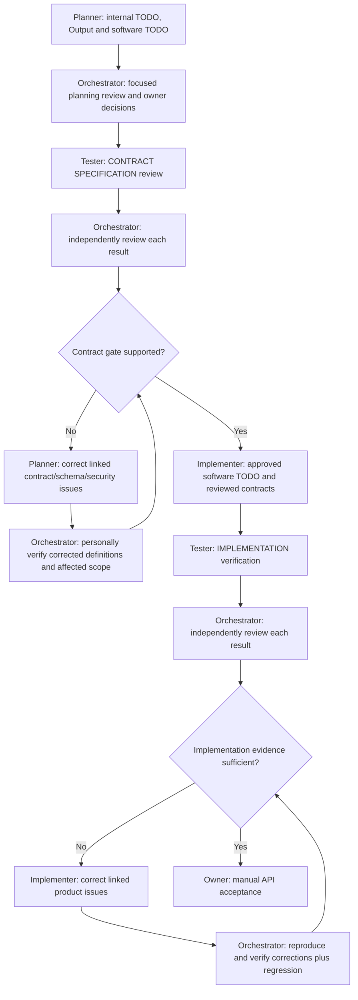

# API-only delivery cycle — contracts, implementation and evidence

Read [backend-only scope](../../../docs/backend-guide/00-navigation/backend-only-scope.md), each assigned role prompt and Roster. This reusable workflow grants no assignment, dispatch or runtime permission. API/domain/data design belongs to Planner; no UI Designer, frontend phase or design TODO exists here.

## 1. Planning and focused review

Planner creates its internal discovery TODO, canonical versioned Output and one software TODO using [Implementer template](../../implementer/templates/todo.md). Output owns requirements/DEC/CHG and approval state. The software TODO owns complete construction details or links mandatory exact authoritative sources: endpoints/requests/successes/errors, schema/access/transactions/migrations where applicable, security, source support, files/responsibilities/dependencies and acceptance verification. Existing approved definitions retain authority; do not create a second editable contract in Output.

Orchestrator reviews scope, source preservation, actual backend guide constraints, proposed alternatives, risks, decisions and per-item readiness. Obtain actual owner decisions for missing material behavior/policy. A focused review is substantive, not silent approval. No implementation starts from an unapproved proposal or unresolved contract/schema/security setting.

## 2. Contract specification gate

Orchestrator gives Tester the actual versioned Output/software TODO and complete API/schema/security definitions for CONTRACT SPECIFICATION review before code. Tester checks requirement coverage, request locations and complete field semantics, success/failure status/header/body/examples, unified errors, auth/resource/tenant rules, data keys/relationships/constraints, concurrency/idempotency, migrations/recovery, security, dependency order, source compatibility and observable ACs. Check a supplied machine-readable contract with existing authorized tooling where available; do not install a validator or generate a fictitious PASS.

This is document validation. No runtime API, auth enforcement, DB behavior, migration, load result or deployed environment is proven by a readable plan. Record runtime-dependent ACs UNVERIFIED with their implementation dependency; meaningful scope exclusions need reasons.

Orchestrator independently reviews each finding, failed/unverified criterion and evidence behind each claimed pass. Recheck exact rules/candidate sources. Formal contract corrections go to Planner with stable IDs, expected versus actual, allowed scope and needed evidence. Planner returns updated definitions/software TODO/Output with impact and approval state. Orchestrator personally verifies corrections and affected consumers/examples/ACs; do not send fixes back to Tester automatically. Material scope/security changes still require their actual owner decision. Missing expertise/tools/evidence remains BLOCKED/UNVERIFIED, not waived by a report.

Keep items WAITING FOR CONTRACT REVIEW until exact reviewed versions and actual Orchestrator disposition/correction evidence are linked. Approval and document review are distinct; neither grants dispatch. Unaffected already-reviewed items may proceed only within actual assignment and permissions.

## 3. Implementation and API verification

Implementer reads approved requirements, the same software TODO, exact contracts/schema/security sources and contract gate evidence. It validates and continues that TODO as its execution checklist, implements only approved backend scope using local syntax, maintains the real backend application map and reports candidate-specific developer checks. No UI package, visual TODO or client source is a prerequisite. Missing/unsafe/inconsistent definitions return through Orchestrator instead of being invented in code.

Orchestrator sends the actual code candidate, approved baseline and developer evidence to Tester for IMPLEMENTATION verification. Tester selects meaningful source/quality/unit/API/integration/contract/security/data/failure/performance/regression checks within its actual authority. Run HTTP assertions against the service at the right boundary; tests do not require a browser. Real persistence/transaction/constraint/migration claims need actual authorized isolated infrastructure; provider doubles exercise only the mocked boundary. Do not claim real integration from stubs or a production service from a starter.

Orchestrator independently reviews each result and its evidence. Confirmed product corrections go to Implementer in a formal issue-linked brief. After a fix, Orchestrator personally reproduces the original failure and executes applicable existing affected/regression checks and npm run check in backend when available. No automatic return to Tester and no closing issues from developer claims/diff appearance alone.

Tester owns its tests, assertions, fixtures and harness; Implementer and Orchestrator may execute authorized suites but not alter them. Missing/new test needs after the initial phase remain explicit gaps for the owner's resolution; do not silently redispatch Tester. A separately owner-authorized later assignment is distinct from the default correction loop.

## 4. Evidence, API handoff and acceptance

Use the single [control record](../templates/todo.md) and [personal correction verification record](../templates/correction-review.md). Preserve original Tester reports and prior candidate evidence. Record VERIFIED BY ORCHESTRATOR only with the actual new candidate, performed method, result and checked scope; never relabel it a Tester retest. Assess affected/shared scope after every correction and invalidate stale evidence. Recurrent failure requires causal investigation, not speculative patch cycling.

Contract/schema/security changes use Planner's DEC/CHG analysis, exact versions, affected consumer/dependency mappings and renewed checks; no external client code is changed without separate authority. Preserve accepted and superseded definitions/history. Disputed findings need contrary evidence and a reasoned disposition, not deletion.

Final delivery includes actual API catalog and complete versioned contracts/examples, unified error dictionary, applicable schema/diagram/migration/recovery, auth/security limits, runnable setup/env names, verification results and unresolved gaps. Versioned OpenAPI is preferred when approved and source-supported; do not invent unsupported schema/tool syntax or silently add a second contract authority. Generated files must match actual handlers/schema and current canonical definitions.

Owner performs manual API acceptance, with actual request/expected-response examples through an authorized HTTP client or approved collection. No frontend website is needed. Automated full-system E2E, scans/load, production calls, migrations and release need actual authorization; normal assigned API/unit/integration tests remain valid verification. Pending manual acceptance blocks product closure. API readiness is not deployment permission.
