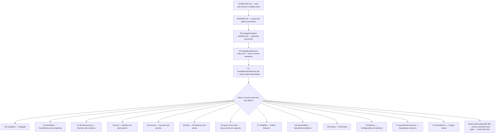

# Backend guide — reading flow and file map

Start here to locate files quickly. This is a navigation document; the linked guides remain the source of rules. Arrows mean **where to read**, not mandatory implementation order or permission to add a subsystem. File summaries describe existing scope and do not replace reading the actual sections.

## Planning entry

Planner must start at this map and the other application's `GUIDE-MAP.md` on every planning assignment. Then read this guide's `README.md` and `00-navigation/agent-workflow.md`, plus `00-navigation/decision-index.md`, verify the fixed architecture in `01-foundation/architecture.md`, and follow the applicable branches below. Record the files/sections and their consequences in the planning TODO/Output. A map-only reading is insufficient. Inspect both guides' relevance even for a one-app change; justify excluded branches from actual scope rather than silently skipping an entire guide. No need to load every specialized file for every task.

## Reading flow

These are routing branches, not a checklist that forces irrelevant features. If sources conflict or a needed decision is not covered, record exact locations and the question for Orchestrator; do not invent a rule from a summary.

## Root files

| File | Short description |
| --- | --- |
| [GUIDE-MAP.md](GUIDE-MAP.md) | This visual entry and complete file catalog. |
| [README.md](README.md) | Guide scope, conventions and existing overview. |

## 00-navigation

| File | Short description |
| --- | --- |
| [agent-workflow.md](00-navigation/agent-workflow.md) | The inspect-to-delivery loop and complexity discipline. |
| [decision-index.md](00-navigation/decision-index.md) | Route a concrete backend question to its primary guide. |

## 01-foundation

| File | Short description |
| --- | --- |
| [initialization.md](01-foundation/initialization.md) | Bootstrap the service and essential engineering foundations. |
| [architecture.md](01-foundation/architecture.md) | Module boundaries, dependency direction and architecture choices. |
| [project-structure.md](01-foundation/project-structure.md) | Place modules, interfaces and infrastructure by responsibility. |
| [complexity-control.md](01-foundation/complexity-control.md) | Require evidence before adding layers, services or infrastructure. |

## 02-domain-and-api

| File | Short description |
| --- | --- |
| [api-design.md](02-domain-and-api/api-design.md) | HTTP operations, payloads, errors, pagination and contract evolution. |
| [domain-logic.md](02-domain-and-api/domain-logic.md) | Business invariants, ownership and use-case responsibilities. |
| [validation.md](02-domain-and-api/validation.md) | Validate inputs at the right boundary and separate business checks. |

## 03-auth

| File | Short description |
| --- | --- |
| [authentication.md](03-auth/authentication.md) | Identity, sessions and authentication lifecycle boundaries. |
| [authorization.md](03-auth/authorization.md) | Permissions, object ownership and tenant-aware access enforcement. |

## 04-security

| File | Short description |
| --- | --- |
| [security-foundations.md](04-security/security-foundations.md) | Threats, injection classes and trust-boundary review. |
| [secrets-management.md](04-security/secrets-management.md) | Credential storage, exposure prevention, rotation and key handling. |

## 05-data

| File | Short description |
| --- | --- |
| [data-architecture.md](05-data/data-architecture.md) | Data ownership, schema, keys, indexes and lifecycle. |
| [data-access.md](05-data/data-access.md) | Query/repository boundaries, connection use and data-access choices. |
| [migrations.md](05-data/migrations.md) | Evolve schema with compatibility and safe release ordering. |
| [transactions.md](05-data/transactions.md) | Atomic multi-step writes, isolation and locking. |
| [concurrency-and-idempotency.md](05-data/concurrency-and-idempotency.md) | Handle races, duplicate operations and safe retries. |

## 06-async-and-scale

| File | Short description |
| --- | --- |
| [background-jobs.md](06-async-and-scale/background-jobs.md) | Decide what belongs in background work and handle job lifecycle. |
| [caching.md](06-async-and-scale/caching.md) | Justify caches and define invalidation and staleness behavior. |
| [events-and-messaging.md](06-async-and-scale/events-and-messaging.md) | Message semantics, delivery guarantees and consumer boundaries. |
| [file-and-object-storage.md](06-async-and-scale/file-and-object-storage.md) | Upload/download security, ownership and storage lifecycle. |
| [realtime.md](06-async-and-scale/realtime.md) | Choose push-update transport and manage live connection behavior. |
| [performance.md](06-async-and-scale/performance.md) | Measure latency, find bottlenecks and evaluate optimizations. |
| [scalability.md](06-async-and-scale/scalability.md) | Increase capacity only with evidence and explicit tradeoffs. |

## 07-reliability

| File | Short description |
| --- | --- |
| [error-handling.md](07-reliability/error-handling.md) | Classify failures and map errors without swallowing them. |
| [reliability.md](07-reliability/reliability.md) | Timeouts, health/readiness, shutdown and bounded degradation. |

## 08-observability

| File | Short description |
| --- | --- |
| [observability.md](08-observability/observability.md) | Logs, metrics, traces, correlation and operational diagnosis. |

## 09-testing

| File | Short description |
| --- | --- |
| [testing-strategy.md](09-testing/testing-strategy.md) | Choose meaningful backend checks, denial cases and regression evidence. |

## 10-delivery

| File | Short description |
| --- | --- |
| [ci-cd.md](10-delivery/ci-cd.md) | Pipeline gates, artifacts and controlled release automation. |
| [configuration.md](10-delivery/configuration.md) | Validated configuration, environments and secret boundaries. |
| [dependencies.md](10-delivery/dependencies.md) | Package selection, supply-chain risk and dependency lifecycle. |
| [deployment.md](10-delivery/deployment.md) | Release sequencing, readiness and supported recovery paths. |
| [documentation-and-decisions.md](10-delivery/documentation-and-decisions.md) | Keep architecture decisions, runbooks and documentation useful. |

## 11-specialized-concerns

| File | Short description |
| --- | --- |
| [multi-tenancy.md](11-specialized-concerns/multi-tenancy.md) | Tenant isolation models and tenant-context propagation. |
| [time-and-money.md](11-specialized-concerns/time-and-money.md) | Timezones, timestamps, currency precision and rounding rules. |
| [webhooks.md](11-specialized-concerns/webhooks.md) | Signed inbound/outbound events, replay protection and redelivery. |
| [feature-flags.md](11-specialized-concerns/feature-flags.md) | Rollout controls, kill switches and flag lifecycle. |
| [privacy-compliance-audit.md](11-specialized-concerns/privacy-compliance-audit.md) | Personal-data lifecycle, retention, exports and audit concerns. |
| [disaster-recovery.md](11-specialized-concerns/disaster-recovery.md) | Backups, restore evidence and recovery objectives. |

## 12-anti-patterns

| File | Short description |
| --- | --- |
| [anti-patterns.md](12-anti-patterns/anti-patterns.md) | Identify recurring backend design failures and find their remedies. |

## Cross-guide route and maintenance

Backend contracts and user-visible failures must be reconciled with the [frontend map](../frontend-guide/GUIDE-MAP.md), particularly HTTP integration, state, UI feedback and security. Technology syntax remains under `workspace/docs/syntax/`; a generic example does not override the project's fixed architecture or role/test ownership.

When files are added, renamed or removed, maintain this catalog and its links together with the existing README navigation. Do not copy technical rules here or claim a document audit proves runtime behavior. If Mermaid is unavailable in the viewer, follow the linked catalog directly.
