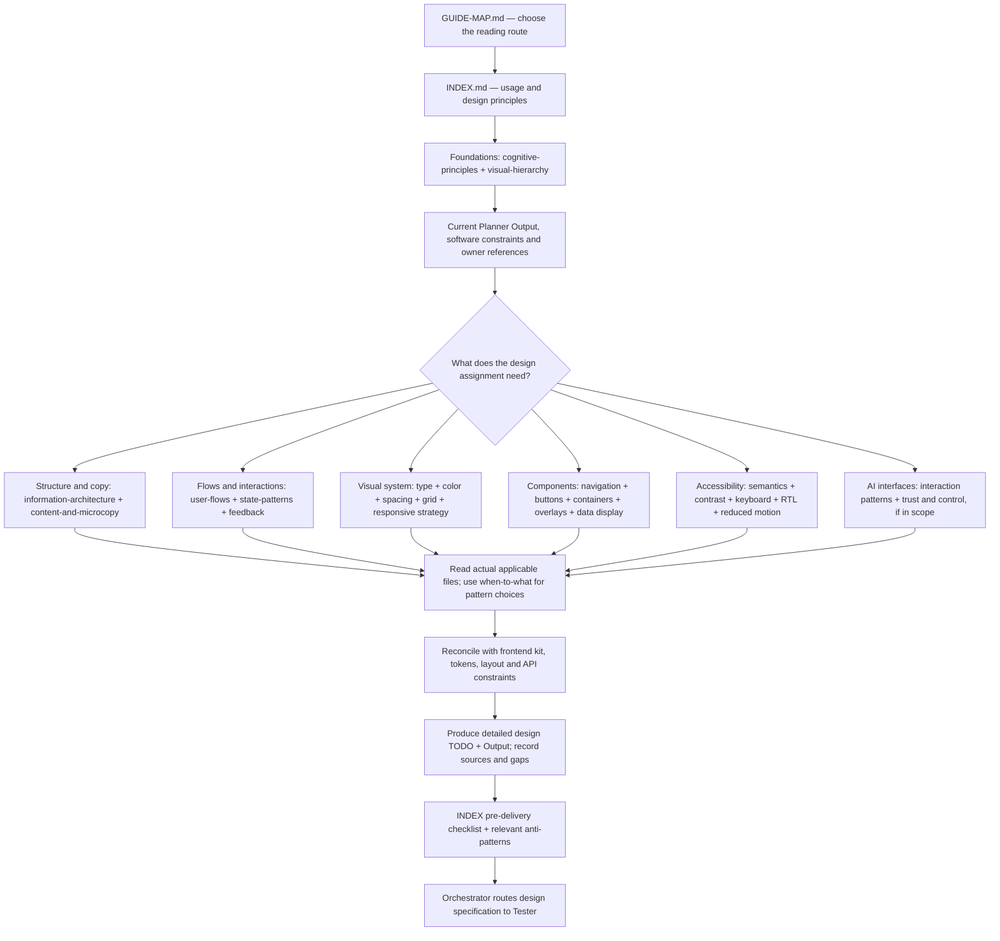

# Design guide — reading flow and file map

Start here on every assigned Designer task. This is the reading roadmap and canonical file catalog, not a product schedule or a second set of design rules. Arrows show where to read; summaries describe file scope and do not replace actual sections. Read this map, then INDEX and its required foundations before choosing task-relevant branches.

## Designer entry and reading flow

The branches can overlap. Accessibility and applicable interaction/responsive requirements are integrated throughout design, not postponed until visual styling finishes. For multi-screen work read user-flows; read content-and-microcopy before layout copy decisions. Preserve the exact mandatory foundations route in INDEX. The flow is a reading aid, not authorization to execute tools, add features or dispatch workers.

## Task routes

| Concern | Read after INDEX and required foundations | Evidence to retain in Designer TODO/Output |
| --- | --- | --- |
| Page hierarchy, navigation or new flow | Information architecture, content/microcopy, user flows, signifiers and relevant navigation/components | Source requirement IDs, entry/exit/recovery, content and hierarchy decisions. |
| Exact layout or responsive specification | Spacing/composition, grids, responsive strategy, spatial management and typography | Element-to-edge/sibling relationships, token values or formulas, bounds and viewport interval rules. |
| Forms or authentication UI | Forms/input, user flows, states, feedback, buttons and keyboard/focus | Approved validation/API dependencies, all applicable states, error placement and focus/recovery behavior. |
| Tokens, brand, themes or reusable components | Design tokens, typography, color, relevant components and frontend kit rules | Reuse versus justified proposal, semantic tokens and source-backed variants. |
| Accessibility or localization | Applicable accessibility pages, plus corresponding components, content and interactions | Specified semantics, keyboard path, contrast targets, RTL/text-resize/motion conditions and verification limits. |
| AI product interface | AI-specific patterns and trust/transparency, plus normal interaction/accessibility routes | Streaming/failure/control states only where required by current scope. |
| Final design review | INDEX pre-delivery checklist and task-relevant anti-pattern files | Actual inspected artifacts, unresolved gaps and self-review evidence; no fabricated runtime results. |

Read [Designer prompt](../../agents/designer/prompt.md) and its [procedure](../../agents/designer/skillz/SKILL.md) for role authority and methods. Record actual files/sections and their consequences, not just a checked map link. Reading only this roadmap does not complete design discovery.

## File catalog

Every file, with what it decides. Open the ones your task touches — not all of them.

**Root**

| File | Decides |
|---|---|
| [GUIDE-MAP.md](GUIDE-MAP.md) | Reading flow, task routes and this complete file catalog. |
| [INDEX.md](INDEX.md) | Guide usage, design principles, pre-delivery QA checklist and recorded source-audit notes. |
| [when-to-what.md](when-to-what.md) | Decision trees: navigation, containers, overlays, friction, onboarding, loading, responsive axis, type, density |

**`foundations/`** — read before anything else; the rest depends on these

| File | Decides |
|---|---|
| [cognitive-principles.md](foundations/cognitive-principles.md) | Why designs work: Fitts, Hick, Miller, Jakob, Tesler, cognitive load |
| [visual-hierarchy.md](foundations/visual-hierarchy.md) | What the user sees first, second, third |
| [signifiers-affordances.md](foundations/signifiers-affordances.md) | How users know what's interactive — most-violated principle in generated UI |
| [information-architecture.md](foundations/information-architecture.md) | What content exists, how it's grouped and labeled, how deep |
| [content-and-microcopy.md](foundations/content-and-microcopy.md) | Every word: buttons, errors, empty states, labels, voice, i18n-safe writing |
| [design-tokens.md](foundations/design-tokens.md) | Storing decisions as tokens; the DTCG format spec |

**`visual-design/`**

| File | Decides |
|---|---|
| [typography.md](visual-design/typography.md) | Type scale, line height, pairing, fluid `clamp()`, `text-wrap`, font loading |
| [color.md](visual-design/color.md) | Palette roles, OKLCH, contrast, dark mode, forced-colors |
| [spacing-composition.md](visual-design/spacing-composition.md) | Whitespace, rhythm, the 4/8px base unit |
| [grid-systems.md](visual-design/grid-systems.md) | Layout structure, alignment, container queries |
| [responsive-strategy.md](visual-design/responsive-strategy.md) | Breakpoints vs. container queries vs. `clamp()`; mobile-first |
| [spatial-management.md](visual-design/spatial-management.md) | z-index layers, stacking, scroll behaviour |

**`interaction-design/`**

| File | Decides |
|---|---|
| [user-flows.md](interaction-design/user-flows.md) | Sequences: entry points, back, interruption, recovery, onboarding, destructive & auth flows |
| [state-patterns.md](interaction-design/state-patterns.md) | The 6 element states and 3 view states; loading, empty, error |
| [feedback-systems.md](interaction-design/feedback-systems.md) | Did it work? Is it working? What went wrong? |
| [forms-input.md](interaction-design/forms-input.md) | Labels, validation, input types, `autocomplete`, multi-step |
| [progressive-disclosure.md](interaction-design/progressive-disclosure.md) | Managing complexity without hiding it |
| [motion.md](interaction-design/motion.md) | When animation is functional; `prefers-reduced-motion` |

**`components/`**

| File | Decides |
|---|---|
| [buttons-ctas.md](components/buttons-ctas.md) | Hierarchy, sizing, states, destructive styling |
| [cards-lists.md](components/cards-lists.md) | Choosing and building the two main content containers |
| [modals-dialogs.md](components/modals-dialogs.md) | Modal vs. popover vs. drawer; native `<dialog>`; Baseline support |
| [navigation.md](components/navigation.md) | Nav patterns that expose the IA; wayfinding |
| [data-display.md](components/data-display.md) | Tables, dashboards, chart selection, accessible & honest data viz |

**`accessibility/`** — WCAG 2.2 AA is non-negotiable

| File | Decides |
|---|---|
| [wcag-essentials.md](accessibility/wcag-essentials.md) | The AA baseline, incl. the four new 2.2 criteria; legal context |
| [contrast-readable.md](accessibility/contrast-readable.md) | Contrast ratios; why not to design for WCAG 3/APCA yet |
| [keyboard-focus.md](accessibility/keyboard-focus.md) | Focus order, visible focus, skip links, focus management |
| [motion-sensitivity.md](accessibility/motion-sensitivity.md) | Reduced motion; what's safe to animate |
| [rtl-i18n.md](accessibility/rtl-i18n.md) | Arabic/Hebrew, logical properties, mirroring, Arabic typography |

**`ai-specific/`**

| File | Decides |
|---|---|
| [ai-interface-patterns.md](ai-specific/ai-interface-patterns.md) | Streaming, prompting, chat & agent UI patterns |
| [trust-transparency.md](ai-specific/trust-transparency.md) | Communicating uncertainty, sources, and control over AI output |

**`anti-patterns/`** — check before delivering

| File | Decides |
|---|---|
| [common-mistakes.md](anti-patterns/common-mistakes.md) | Frequent, non-deceptive errors that degrade the experience |
| [dark-patterns.md](anti-patterns/dark-patterns.md) | Manipulation — never acceptable, with legal exposure |
| [ai-design-cliches.md](anti-patterns/ai-design-cliches.md) | The specific tells of generated design |
| [design-anti-averaging.md](anti-patterns/design-anti-averaging.md) | Methodology for designs that feel intentional, not averaged |

## Cross-guide route and maintenance

Reconcile recommendations with the [frontend map](../frontend-guide/GUIDE-MAP.md) and actual kit/token/layout/accessibility rules. Business behavior comes from approved Planner Output; wire behavior comes from exact owner-supplied API sources under [frontend-only scope](../frontend-guide/00-navigation/frontend-only-scope.md). No backend guide is required. The [syntax map](../syntax/GUIDE-MAP.md) routes technical references, not new requirements. Report conflicts through Orchestrator.

Use the [detailed design handoff procedure](../../agents/designer/skillz/detailed-design-handoff.md) and [design TODO template](../../agents/designer/templates/design-todo.md) for measurable implementation specifications. The [delivery cycle](../../agents/orchestrator/skillz/delivery-cycle.md) governs design testing and Orchestrator's individual report/correction review. This map neither replaces that cycle nor claims a rendered or functional interface was verified.

Keep this catalog current when files change; INDEX links here rather than maintaining a second file inventory. Existing freshness/audit statements remain in their source documents; this navigation update is not a new external source audit. If Mermaid is unavailable, follow the task-route table and linked catalog directly.
