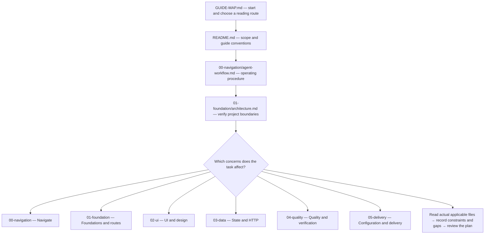

# Frontend guide — reading flow and file map

Start here to locate files quickly. This is a navigation document; the linked guides remain the source of rules. Arrows mean **where to read**, not mandatory implementation order or permission to add a subsystem. File summaries describe existing scope and do not replace reading the actual sections.

## Planning entry

Planner starts at this map, [frontend-only scope](00-navigation/frontend-only-scope.md), README, workflow and architecture, then actual relevant branches. Read each consumed owner API definition completely. Record exact files/sections, resulting constraints, exclusions/reasons and missing sources. No second application or backend guide is required; a map-only read is insufficient.

## Reading flow

These are routing branches, not a checklist that forces irrelevant features. If sources conflict or a needed decision is not covered, record exact locations and the question for Orchestrator; do not invent a rule from a summary.

## Root files

| File | Short description |
| --- | --- |
| [GUIDE-MAP.md](GUIDE-MAP.md) | This visual entry and complete file catalog. |
| [README.md](README.md) | Guide scope, conventions and existing overview. |

## 00-navigation

| File | Short description |
| --- | --- |
| [frontend-only-scope.md](00-navigation/frontend-only-scope.md) | Mandatory role scope, owner API authority and frontend-only limits. |
| [agent-workflow.md](00-navigation/agent-workflow.md) | How to inspect, plan, verify and report a task. |
| [decision-framework.md](00-navigation/decision-framework.md) | Choose code placement, state ownership and justified abstractions. |

## 01-foundation

| File | Short description |
| --- | --- |
| [initialization.md](01-foundation/initialization.md) | Establish the approved app, tooling and initial quality gates. |
| [architecture.md](01-foundation/architecture.md) | Rendering boundaries, dependency direction and shared responsibilities. |
| [project-structure.md](01-foundation/project-structure.md) | Canonical folders and the responsibility of each source area. |
| [routing.md](01-foundation/routing.md) | Routes, layouts, protected pages, loading and error boundaries. |

## 02-ui

| File | Short description |
| --- | --- |
| [design-tokens.md](02-ui/design-tokens.md) | Semantic colors, size scales and token usage. |
| [theme-and-dark-mode.md](02-ui/theme-and-dark-mode.md) | Theme files, fonts, brand values and light/dark wiring. |
| [components.md](02-ui/components.md) | UI component responsibilities, composition and interaction states. |
| [forms.md](02-ui/forms.md) | Form display, validation, submission and feedback responsibilities. |
| [layout-and-responsive.md](02-ui/layout-and-responsive.md) | Fluid layout, breakpoints and responsive adaptation. |
| [data-display-and-feedback.md](02-ui/data-display-and-feedback.md) | Tables, cards, empty states, messages and dialogs. |
| [accessibility.md](02-ui/accessibility.md) | Semantic UI, keyboard/focus behavior and accessibility requirements. |
| [portability.md](02-ui/portability.md) | Keep the reusable UI kit independent of product behavior. |

## 03-data

| File | Short description |
| --- | --- |
| [backend-integration.md](03-data/backend-integration.md) | Frontend-only HTTP integration, owner-supplied contracts and explicit session/error mapping. |
| [state-and-data.md](03-data/state-and-data.md) | Assign state ownership and choose fetching, mutation and revalidation behavior. |

## 04-quality

| File | Short description |
| --- | --- |
| [security.md](04-quality/security.md) | Frontend defense in depth, trust boundaries and exposure prevention. |
| [performance.md](04-quality/performance.md) | Loading, responsiveness, visual stability and measured optimization. |
| [resilience.md](04-quality/resilience.md) | Loading/error recovery and graceful user-facing failure states. |
| [testing.md](04-quality/testing.md) | Test ownership, appropriate checks and the owner's E2E boundary. |
| [dependencies.md](04-quality/dependencies.md) | Evaluate package need, maintenance, cost and compatibility. |
| [code-quality.md](04-quality/code-quality.md) | Linting, formatting, TypeScript and maintainable source conventions. |
| [anti-patterns.md](04-quality/anti-patterns.md) | Review common architecture, component and state mistakes. |

## 05-delivery

| File | Short description |
| --- | --- |
| [environments-and-config.md](05-delivery/environments-and-config.md) | Configuration, environment separation and safe client/server values. |
| [delivery-and-observability.md](05-delivery/delivery-and-observability.md) | Delivery checks, rollout concerns and useful runtime telemetry. |

## Cross-guide route and maintenance

Frontend HTTP/auth/data plans must match the exact owner-supplied API sources and [frontend-only scope](00-navigation/frontend-only-scope.md). Missing external contracts return to the owner; there is no backend guide or database implementation here. Technology syntax remains under `workspace/docs/syntax/`; reference examples never assign external service behavior.

When files are added, renamed or removed, maintain this catalog and its links together with the existing README navigation. Do not copy technical rules here or claim a document audit proves runtime behavior. If Mermaid is unavailable in the viewer, follow the linked catalog directly.
