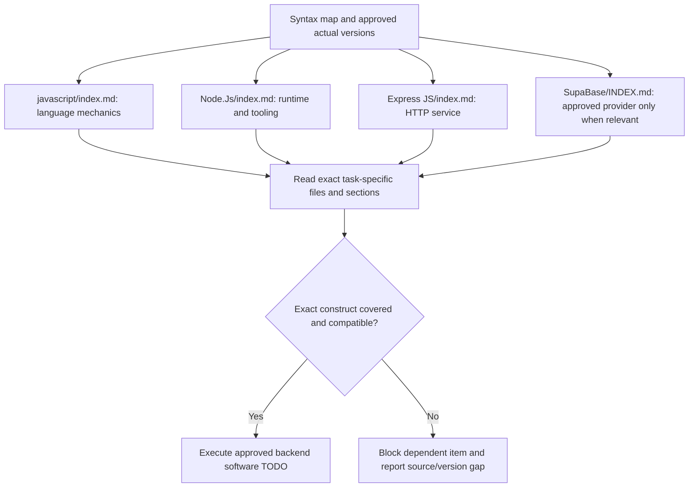

# Syntax — backend reading roadmap and file map

Mandatory Implementer entry. Read the [exclusive syntax policy](../../agents/implementer/skillz/syntax-policy.md), [backend-only scope](../backend-guide/00-navigation/backend-only-scope.md) and [version policy](../backend-guide/00-navigation/source-version-policy.md). This map inventories actual local references, not installed packages or a newest-version guarantee.

No frontend framework or design system is included. Backend guide owns architecture; syntax owns allowed mechanics. Supabase references do not prove a selected/connected provider. Missing support for another technology requires authorized source maintenance; no personal Skill, remembered API or external research bypass. Testing examples do not change Tester ownership or authorize live side effects.

## javascript

| File | Purpose / reading scope |
| --- | --- |
| [anti-patterns.md](<javascript/anti-patterns.md>) | Obsolete, deprecated, and dangerous patterns to reject |
| [async.md](<javascript/async.md>) | Async/await, event loop, fetch, cancellation, concurrency |
| [classes.md](<javascript/classes.md>) | Classes, private fields, inheritance, `instanceof` |
| [datetime.md](<javascript/datetime.md>) | Date pitfalls, timezones, Temporal |
| [functions.md](<javascript/functions.md>) | `this` binding, closures, memory leaks |
| [index.md](<javascript/index.md>) | Technology scope, version notes and detailed reading index. |
| [modern-features.md](<javascript/modern-features.md>) | Shipped features worth adopting (ES2024+) |
| [modules.md](<javascript/modules.md>) | ESM rules, CJS interop, package exports |
| [regex.md](<javascript/regex.md>) | `lastIndex` state, `matchAll` vs `match`, flags, dynamic patterns |
| [runtime-gotchas.md](<javascript/runtime-gotchas.md>) | Node/Bun/Deno behavioral differences |
| [security.md](<javascript/security.md>) | XSS, prototype pollution, injection, ReDoS, Trusted Types, supply chain |
| [type-safety.md](<javascript/type-safety.md>) | Coercion rules, numbers/precision, JSDoc type checking |

## Node.Js

| File | Purpose / reading scope |
| --- | --- |
| [concurrency.md](<Node.Js/concurrency.md>) | Event loop, worker_threads, child_process, cluster |
| [deployment.md](<Node.Js/deployment.md>) | Docker, graceful shutdown, health endpoints, SEA |
| [deprecations.md](<Node.Js/deprecations.md>) | Removed/runtime-deprecated APIs, dead packages, audit checklist |
| [error-handling.md](<Node.Js/error-handling.md>) | Crash semantics, exit codes, error causes, debugging flags |
| [frameworks.md](<Node.Js/frameworks.md>) | Fastify / Express 5 / Hono / NestJS decision table |
| [index.md](<Node.Js/index.md>) | Technology scope, version notes and detailed reading index. |
| [module-system.md](<Node.Js/module-system.md>) | ESM/CJS, require(esm), exports maps, interop diagnostics |
| [runtime-apis.md](<Node.Js/runtime-apis.md>) | Web-platform globals, node:sqlite, streams, fs/promises, ALS |
| [security.md](<Node.Js/security.md>) | Permission model, supply chain, input validation, secrets |
| [testing.md](<Node.Js/testing.md>) | node:test vs Vitest, mocking, deterministic tests, CI order |
| [tooling.md](<Node.Js/tooling.md>) | npm/pnpm/Yarn, ESLint 10 flat config, built-in dev replacements |
| [typescript.md](<Node.Js/typescript.md>) | Native type stripping, erasable-syntax limits, tsconfig |
| [versions-and-releases.md](<Node.Js/versions-and-releases.md>) | Release table, LTS policy, annual-cadence change, upgrade rules |

## Express JS

| File | Purpose / reading scope |
| --- | --- |
| [error-handling.md](<Express JS/error-handling.md>) | Async forwarding, error classes, centralized handler, crash semantics |
| [health-shutdown.md](<Express JS/health-shutdown.md>) | Liveness/readiness probes, SIGTERM handling, Kubernetes wiring |
| [index.md](<Express JS/index.md>) | Technology scope, version notes and detailed reading index. |
| [middleware.md](<Express JS/middleware.md>) | Pipeline order, body/query parsing (no cookies), static files, pino logging, multer uploads |
| [migration-v4-to-v5.md](<Express JS/migration-v4-to-v5.md>) | Removed APIs, silent behaviour changes, path-syntax rewrites, codemods |
| [overview.md](<Express JS/overview.md>) | Version/support landscape, real dependency tree, Node compatibility, when *not* to use Express |
| [performance.md](<Express JS/performance.md>) | NODE_ENV, workers, keep-alive timeouts, ETag/caching, reverse proxy, observability |
| [project-structure.md](<Express JS/project-structure.md>) | Folder layout, app/index split, env validation, npm scripts |
| [routing.md](<Express JS/routing.md>) | path-to-regexp v8 syntax, `req.params` semantics, Router, request/response API |
| [security.md](<Express JS/security.md>) | trust proxy, helmet, CORS, rate limiting, zod validation, CSRF, JWT, CVE table |
| [streaming.md](<Express JS/streaming.md>) | Large responses, `pipeline`, SSE, downloads, backpressure |
| [testing.md](<Express JS/testing.md>) | Vitest 4 + supertest, app-factory pattern, middleware isolation |

## SupaBase

| File | Purpose / reading scope |
| --- | --- |
| [architecture.md](<SupaBase/architecture.md>) | Components, request flow, services |
| [auth.md](<SupaBase/auth.md>) | Providers, JWT, sessions, the Express (server-side) setup |
| [cli-migrations.md](<SupaBase/cli-migrations.md>) | Local dev, migrations, branching, CI/CD |
| [client-libs.md](<SupaBase/client-libs.md>) | supabase-js v2, TypeScript, the two Express clients |
| [database.md](<SupaBase/database.md>) | Schema design, PostgREST, connections, pooling, indexes, JSONB |
| [edge-functions.md](<SupaBase/edge-functions.md>) | Deno runtime, patterns, background tasks, caveats |
| [gotchas.md](<SupaBase/gotchas.md>) | Common mistakes, pitfalls, what to avoid |
| [INDEX.md](<SupaBase/INDEX.md>) | Technology scope, version notes and detailed reading index. |
| [pricing.md](<SupaBase/pricing.md>) | Plans, limits, real-world cost expectations |
| [realtime.md](<SupaBase/realtime.md>) | Postgres Changes, Broadcast, Presence, limits |
| [rls-patterns.md](<SupaBase/rls-patterns.md>) | Production RLS policies, multi-tenant, testing, performance |
| [security-keys.md](<SupaBase/security-keys.md>) | API keys (legacy vs new), RLS fundamentals, key hygiene |
| [storage.md](<SupaBase/storage.md>) | Buckets, policies, image transforms, CDN |
| [vector-ai.md](<SupaBase/vector-ai.md>) | pgvector, embeddings, semantic search |
