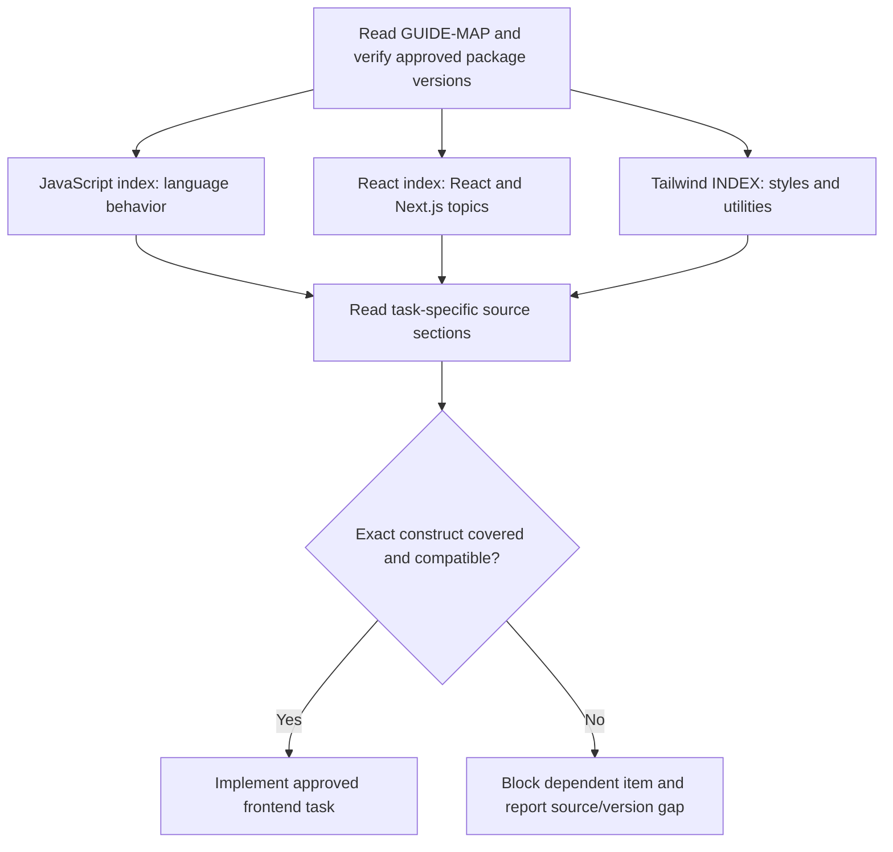

# Syntax — frontend reading roadmap and file map

Mandatory technical entry for Implementer. Start here, then actual indexes/pages for the assigned task. This catalog describes the preserved local reference, not a certification of latest upstream releases. Read the [exclusive syntax policy](../../agents/implementer/skillz/syntax-policy.md) and [frontend-only scope](../frontend-guide/00-navigation/frontend-only-scope.md).

No separate backend or database stack is included. Node.js running Next.js tooling does not authorize building a service. Any backend examples inside preserved references are contextual only. Broad chapter titles do not prove exact API support; Next.js/TypeScript topics may be distributed across React pages. No external research, package upgrade or source maintenance is authorized by this map.

## javascript

| File | Purpose / reading scope |
| --- | --- |
| [anti-patterns.md](<javascript/anti-patterns.md>) | Obsolete, deprecated, and dangerous patterns to reject |
| [async.md](<javascript/async.md>) | Async/await, event loop, fetch, cancellation, concurrency |
| [classes.md](<javascript/classes.md>) | Classes, private fields, inheritance, `instanceof` |
| [datetime.md](<javascript/datetime.md>) | Date pitfalls, timezones, Temporal |
| [functions.md](<javascript/functions.md>) | `this` binding, closures, memory leaks |
| [index.md](<javascript/index.md>) | Technology scope, version notes and detailed reading index. |
| [modern-features.md](<javascript/modern-features.md>) | Shipped features worth adopting (ES2024+) |
| [modules.md](<javascript/modules.md>) | ESM rules, CJS interop, package exports |
| [regex.md](<javascript/regex.md>) | `lastIndex` state, `matchAll` vs `match`, flags, dynamic patterns |
| [runtime-gotchas.md](<javascript/runtime-gotchas.md>) | Node/Bun/Deno behavioral differences |
| [security.md](<javascript/security.md>) | XSS, prototype pollution, injection, ReDoS, Trusted Types, supply chain |
| [type-safety.md](<javascript/type-safety.md>) | Coercion rules, numbers/precision, JSDoc type checking |

## react

| File | Purpose / reading scope |
| --- | --- |
| [a11y.md](<react/a11y.md>) | Accessibility: semantics, forms, focus, jsx-a11y lint |
| [build-and-tooling.md](<react/build-and-tooling.md>) | Vite, linting, env vars, monorepos |
| [components-and-jsx.md](<react/components-and-jsx.md>) | Function components, JSX, XSS, portals, DOM refs |
| [data-fetching.md](<react/data-fetching.md>) | TanStack Query vs RSC decision matrix |
| [deprecations.md](<react/deprecations.md>) | Removed/deprecated APIs + codemods |
| [error-handling.md](<react/error-handling.md>) | Error boundaries, hydration mismatches |
| [forms.md](<react/forms.md>) | useActionState + Zod, Server Actions; React Hook Form for complex forms |
| [hook-patterns.md](<react/hook-patterns.md>) | Custom hooks, effect patterns, useEffectEvent |
| [hooks-reference.md](<react/hooks-reference.md>) | Hook API table (16.8 → 19.2) |
| [index.md](<react/index.md>) | Technology scope, version notes and detailed reading index. |
| [optimization.md](<react/optimization.md>) | Profiling, virtualization, code splitting |
| [props-and-state.md](<react/props-and-state.md>) | Props rules, state primitives |
| [react-compiler.md](<react/react-compiler.md>) | Compiler setup, capabilities, migration |
| [rendering-model.md](<react/rendering-model.md>) | Render/reconcile/commit, keys, concurrent features |
| [rendering-strategies.md](<react/rendering-strategies.md>) | CSR/SSR/SSG/ISR/streaming/PPR, `<Activity />` |
| [routing-and-frameworks.md](<react/routing-and-frameworks.md>) | Next.js / React Router / TanStack Start |
| [rsc-architecture.md](<react/rsc-architecture.md>) | Server Components boundaries, 'use client'/'use server' |
| [state-strategy.md](<react/state-strategy.md>) | Decision tree: local/server/global/form state |
| [styling.md](<react/styling.md>) | Tailwind v4, CSS Modules, what's dead |
| [testing.md](<react/testing.md>) | Vitest + RTL, Playwright |
| [typescript.md](<react/typescript.md>) | TS setup, React 19 type changes |
| [url-state.md](<react/url-state.md>) | Search params as state |

## Tailwind css

| File | Purpose / reading scope |
| --- | --- |
| [architecture.md](<Tailwind css/architecture.md>) | Oxide engine, modern CSS foundations, build pipeline, performance |
| [best-practices.md](<Tailwind css/best-practices.md>) | Component extraction, `@apply` guidance, anti-patterns, performance, naming |
| [breaking-changes.md](<Tailwind css/breaking-changes.md>) | Complete v3→v4 migration reference with diffs |
| [configuration.md](<Tailwind css/configuration.md>) | `@theme`, `@utility`, `@custom-variant`, `@source`, `@plugin` directives, design tokens |
| [dark-mode.md](<Tailwind css/dark-mode.md>) | `prefers-color-scheme`, class-based, data-attribute, `@custom-variant dark` |
| [ecosystem.md](<Tailwind css/ecosystem.md>) | Plugin compat (`@plugin`), v3 compat layer, UnoCSS/PandaCSS comparison, shadcn/ui |
| [INDEX.md](<Tailwind css/INDEX.md>) | Technology scope, version notes and detailed reading index. |
| [integration.md](<Tailwind css/integration.md>) | Vite plugin, PostCSS, webpack, Next.js, CLI, browser build, framework-specific setup |
| [new-features.md](<Tailwind css/new-features.md>) | All v4.x features: container queries, 3D transforms, gradients, masks, text-shadow, logical properties, scrollbars, new variants/utilities per release |

## Source gaps and evidence

Record exact source file/heading, documented scope, approved installed versions and the implementation item it supports. A passing build does not waive source policy; missing constructs require an authorized source update or other owner resolution before dependent code. The source files are preserved from the original frontend template; this migration does not claim a fresh upstream-version audit.
