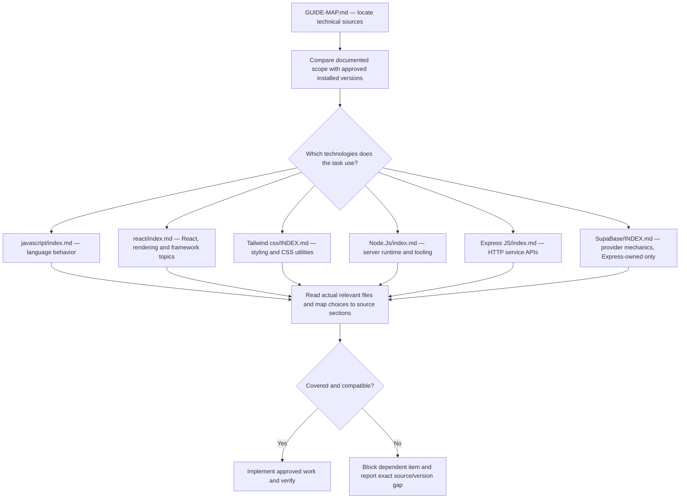

# Syntax — reading roadmap and file map

This is the mandatory technical entry for Implementer. Start here, choose the relevant technology index, then read the actual task-specific files before code. This map describes the existing local reference; it does not certify current upstream releases or replace the [exclusive syntax policy](../../agents/implementer/skillz/syntax-policy.md).

## Reading flow

Arrows are reading routes, not build order or permission to adopt a technology. Frontend/backend engineering guides decide architecture and project constraints. The fixed app boundary remains Next.js → Express on Node.js → database. Provider examples never authorize browser/Next.js database access. Testing chapters inform technical understanding; test ownership and automated-E2E authorization remain governed by the project roles and guides.

Next.js and TypeScript topics currently appear within React/Node pages; this folder has no dedicated index for every possible package or API. A broad folder name is not evidence that an exact construct is covered. Missing detail is a source gap under the policy, not permission to fill it from memory or a personal Skill. No external research, source update or package upgrade is authorized by this map.

## File catalog

[GUIDE-MAP.md](GUIDE-MAP.md) — this reading route and catalog. Summaries below are derived from each existing technology index and describe coverage rather than recommendations. Version-sensitive headings or example technologies must be checked in the actual source and against the approved app version.

### Express JS

| File | Short description |
| --- | --- |
| [index.md](<Express JS/index.md>) | Technology scope, version notes and detailed reading index. |
| [overview.md](<Express JS/overview.md>) | Version/support landscape, real dependency tree, Node compatibility, when *not* to use Express |
| [migration-v4-to-v5.md](<Express JS/migration-v4-to-v5.md>) | Removed APIs, silent behaviour changes, path-syntax rewrites, codemods |
| [routing.md](<Express JS/routing.md>) | path-to-regexp v8 syntax, `req.params` semantics, Router, request/response API |
| [middleware.md](<Express JS/middleware.md>) | Pipeline order, body/query parsing (no cookies), static files, pino logging, multer uploads |
| [error-handling.md](<Express JS/error-handling.md>) | Async forwarding, error classes, centralized handler, crash semantics |
| [security.md](<Express JS/security.md>) | trust proxy, helmet, CORS, rate limiting, zod validation, CSRF, JWT, CVE table |
| [performance.md](<Express JS/performance.md>) | NODE_ENV, workers, keep-alive timeouts, ETag/caching, reverse proxy, observability |
| [streaming.md](<Express JS/streaming.md>) | Large responses, `pipeline`, SSE, downloads, backpressure |
| [health-shutdown.md](<Express JS/health-shutdown.md>) | Liveness/readiness probes, SIGTERM handling, Kubernetes wiring |
| [testing.md](<Express JS/testing.md>) | Vitest 4 + supertest, app-factory pattern, middleware isolation |
| [project-structure.md](<Express JS/project-structure.md>) | Folder layout, app/index split, env validation, npm scripts |

### javascript

| File | Short description |
| --- | --- |
| [index.md](<javascript/index.md>) | Technology scope, version notes and detailed reading index. |
| [anti-patterns.md](<javascript/anti-patterns.md>) | Obsolete, deprecated, and dangerous patterns to reject |
| [async.md](<javascript/async.md>) | Async/await, event loop, fetch, cancellation, concurrency |
| [modules.md](<javascript/modules.md>) | ESM rules, CJS interop, package exports |
| [type-safety.md](<javascript/type-safety.md>) | Coercion rules, numbers/precision, JSDoc type checking |
| [datetime.md](<javascript/datetime.md>) | Date pitfalls, timezones, Temporal |
| [functions.md](<javascript/functions.md>) | `this` binding, closures, memory leaks |
| [classes.md](<javascript/classes.md>) | Classes, private fields, inheritance, `instanceof` |
| [security.md](<javascript/security.md>) | XSS, prototype pollution, injection, ReDoS, Trusted Types, supply chain |
| [regex.md](<javascript/regex.md>) | `lastIndex` state, `matchAll` vs `match`, flags, dynamic patterns |
| [modern-features.md](<javascript/modern-features.md>) | Shipped features worth adopting (ES2024+) |
| [runtime-gotchas.md](<javascript/runtime-gotchas.md>) | Node/Bun/Deno behavioral differences |

### Node.Js

| File | Short description |
| --- | --- |
| [index.md](<Node.Js/index.md>) | Technology scope, version notes and detailed reading index. |
| [versions-and-releases.md](<Node.Js/versions-and-releases.md>) | Release table, LTS policy, annual-cadence change, upgrade rules |
| [module-system.md](<Node.Js/module-system.md>) | ESM/CJS, require(esm), exports maps, interop diagnostics |
| [runtime-apis.md](<Node.Js/runtime-apis.md>) | Web-platform globals, node:sqlite, streams, fs/promises, ALS |
| [typescript.md](<Node.Js/typescript.md>) | Native type stripping, erasable-syntax limits, tsconfig |
| [concurrency.md](<Node.Js/concurrency.md>) | Event loop, worker_threads, child_process, cluster |
| [error-handling.md](<Node.Js/error-handling.md>) | Crash semantics, exit codes, error causes, debugging flags |
| [security.md](<Node.Js/security.md>) | Permission model, supply chain, input validation, secrets |
| [testing.md](<Node.Js/testing.md>) | node:test vs Vitest, mocking, deterministic tests, CI order |
| [frameworks.md](<Node.Js/frameworks.md>) | Fastify / Express 5 / Hono / NestJS decision table |
| [tooling.md](<Node.Js/tooling.md>) | npm/pnpm/Yarn, ESLint 10 flat config, built-in dev replacements |
| [deployment.md](<Node.Js/deployment.md>) | Docker, graceful shutdown, health endpoints, SEA |
| [deprecations.md](<Node.Js/deprecations.md>) | Removed/runtime-deprecated APIs, dead packages, audit checklist |

### react

| File | Short description |
| --- | --- |
| [index.md](<react/index.md>) | Technology scope, version notes and detailed reading index. |
| [components-and-jsx.md](<react/components-and-jsx.md>) | Function components, JSX, XSS, portals, DOM refs |
| [a11y.md](<react/a11y.md>) | Accessibility: semantics, forms, focus, jsx-a11y lint |
| [props-and-state.md](<react/props-and-state.md>) | Props rules, state primitives |
| [rendering-model.md](<react/rendering-model.md>) | Render/reconcile/commit, keys, concurrent features |
| [hooks-reference.md](<react/hooks-reference.md>) | Hook API table (16.8 → 19.2) |
| [hook-patterns.md](<react/hook-patterns.md>) | Custom hooks, effect patterns, useEffectEvent |
| [error-handling.md](<react/error-handling.md>) | Error boundaries, hydration mismatches |
| [rsc-architecture.md](<react/rsc-architecture.md>) | Server Components boundaries, 'use client'/'use server' |
| [rendering-strategies.md](<react/rendering-strategies.md>) | CSR/SSR/SSG/ISR/streaming/PPR, `<Activity />` |
| [state-strategy.md](<react/state-strategy.md>) | Decision tree: local/server/global/form state |
| [url-state.md](<react/url-state.md>) | Search params as state |
| [data-fetching.md](<react/data-fetching.md>) | TanStack Query vs RSC decision matrix |
| [react-compiler.md](<react/react-compiler.md>) | Compiler setup, capabilities, migration |
| [optimization.md](<react/optimization.md>) | Profiling, virtualization, code splitting |
| [styling.md](<react/styling.md>) | Tailwind v4, CSS Modules, what's dead |
| [forms.md](<react/forms.md>) | useActionState + Zod, Server Actions; React Hook Form for complex forms |
| [routing-and-frameworks.md](<react/routing-and-frameworks.md>) | Next.js / React Router / TanStack Start |
| [testing.md](<react/testing.md>) | Vitest + RTL, Playwright |
| [typescript.md](<react/typescript.md>) | TS setup, React 19 type changes |
| [build-and-tooling.md](<react/build-and-tooling.md>) | Vite, linting, env vars, monorepos |
| [deprecations.md](<react/deprecations.md>) | Removed/deprecated APIs + codemods |

### SupaBase

| File | Short description |
| --- | --- |
| [INDEX.md](<SupaBase/INDEX.md>) | Technology scope, version notes and detailed reading index. |
| [architecture.md](<SupaBase/architecture.md>) | Components, request flow, services |
| [security-keys.md](<SupaBase/security-keys.md>) | API keys (legacy vs new), RLS fundamentals, key hygiene |
| [rls-patterns.md](<SupaBase/rls-patterns.md>) | Production RLS policies, multi-tenant, testing, performance |
| [database.md](<SupaBase/database.md>) | Schema design, PostgREST, connections, pooling, indexes, JSONB |
| [auth.md](<SupaBase/auth.md>) | Providers, JWT, sessions, the Express (server-side) setup |
| [realtime.md](<SupaBase/realtime.md>) | Postgres Changes, Broadcast, Presence, limits |
| [storage.md](<SupaBase/storage.md>) | Buckets, policies, image transforms, CDN |
| [edge-functions.md](<SupaBase/edge-functions.md>) | Deno runtime, patterns, background tasks, caveats |
| [vector-ai.md](<SupaBase/vector-ai.md>) | pgvector, embeddings, semantic search |
| [cli-migrations.md](<SupaBase/cli-migrations.md>) | Local dev, migrations, branching, CI/CD |
| [client-libs.md](<SupaBase/client-libs.md>) | supabase-js v2, TypeScript, the two Express clients |
| [gotchas.md](<SupaBase/gotchas.md>) | Common mistakes, pitfalls, what to avoid |
| [pricing.md](<SupaBase/pricing.md>) | Plans, limits, real-world cost expectations |

### Tailwind css

| File | Short description |
| --- | --- |
| [INDEX.md](<Tailwind css/INDEX.md>) | Technology scope, version notes and detailed reading index. |
| [architecture.md](<Tailwind css/architecture.md>) | Oxide engine, modern CSS foundations, build pipeline, performance |
| [configuration.md](<Tailwind css/configuration.md>) | `@theme`, `@utility`, `@custom-variant`, `@source`, `@plugin` directives, design tokens |
| [breaking-changes.md](<Tailwind css/breaking-changes.md>) | Complete v3→v4 migration reference with diffs |
| [new-features.md](<Tailwind css/new-features.md>) | All v4.x features: container queries, 3D transforms, gradients, masks, text-shadow, logical properties, scrollbars, new variants/utilities per release |
| [integration.md](<Tailwind css/integration.md>) | Vite plugin, PostCSS, webpack, Next.js, CLI, browser build, framework-specific setup |
| [dark-mode.md](<Tailwind css/dark-mode.md>) | `prefers-color-scheme`, class-based, data-attribute, `@custom-variant dark` |
| [best-practices.md](<Tailwind css/best-practices.md>) | Component extraction, `@apply` guidance, anti-patterns, performance, naming |
| [ecosystem.md](<Tailwind css/ecosystem.md>) | Plugin compat (`@plugin`), v3 compat layer, UnoCSS/PandaCSS comparison, shadcn/ui |

## Maintenance

Keep links and coverage synchronized with actual local files and technology indexes when authorized reference changes occur. Do not copy API rules into this map. A successful source-link check does not establish that reference examples were executed or a product works. If the viewer cannot render Mermaid, follow the linked catalog.
